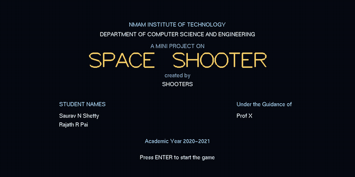
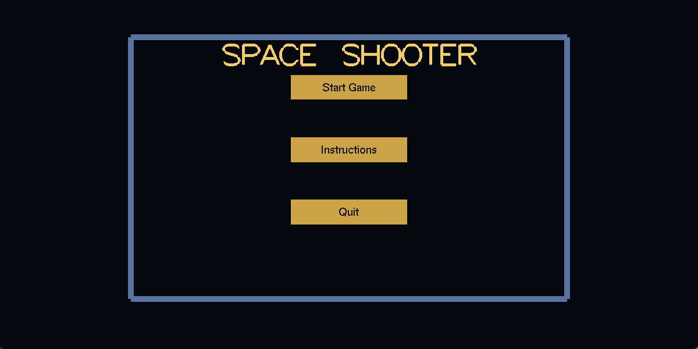
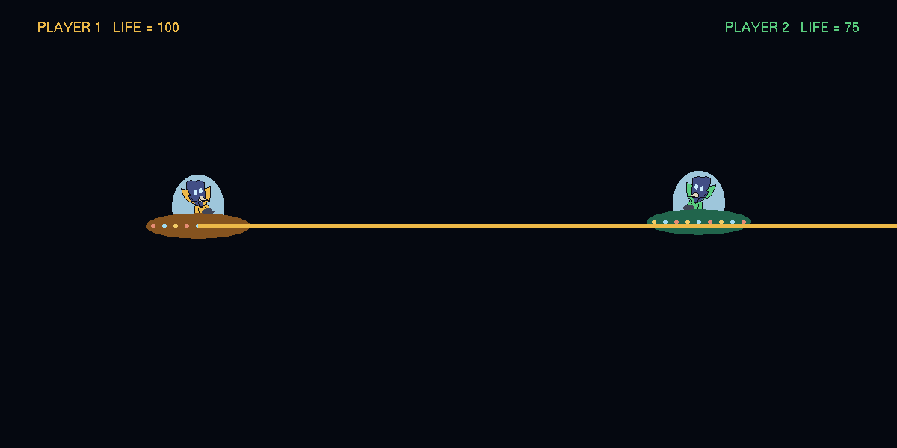
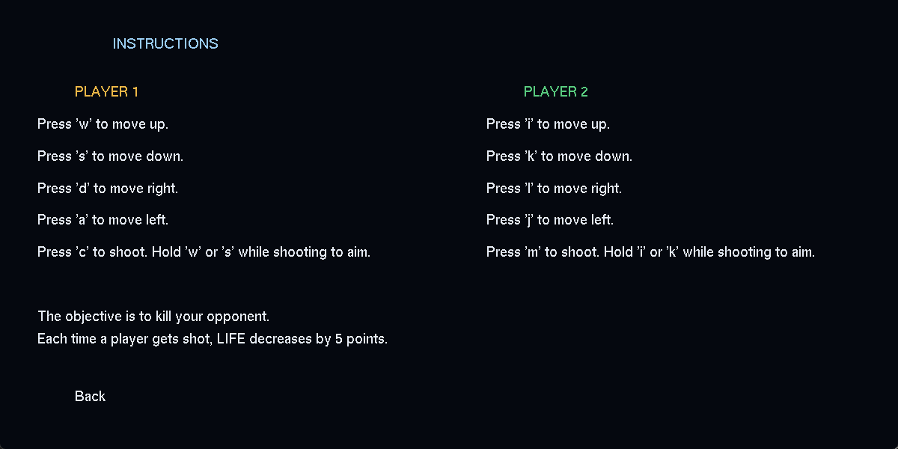

<h1 align="center"> 
    <a href="https://rajathpi.github.io/space-shooter/">Space Shooter</a>  
    
</h1>
<!-- <a href="https://raw.githubusercontent.com/rajathpi/space-shooter/main/main.cpp">
  Code
  
  
 </a> -->


### OpenGL project on the Space Shooter 
<p align="center">

</p>

<p>
</p>
<p>
</p>


## **Installation**

1) Install [CodeBlocks](https://www.codeblocks.org/downloads/binaries/)<br>
2) Install [OpenGL](https://www.transmissionzero.co.uk/software/freeglut-devel/)<br>

Or build it straight from the command line, once freeglut is installed:

```
g++ main.cpp -o space-shooter -lfreeglut -lopengl32 -lglu32     # Windows
g++ main.cpp -o space-shooter -lglut -lGL -lGLU                 # Linux
```


## **Game Description**

*Keyboard controls for PLAYER 1* : 
> W - UP <br />
> S - DOWN <br />
> A - LEFT <br />
> D - RIGHT <br />
> C - to shoot. Hold 'w' or 's' while shooting to aim. <br />  

*Keyboard controls for PLAYER 2* : 
> I - UP <br />
> K - DOWN <br />
> J - LEFT <br />
> L - RIGHT <br />
> M - to shoot. Hold 'i' or 'k' while shooting to aim. <br />  
                                                                              
## **Objective**
                      
> Kill your opponent. <br />
> Each time a player gets shot, LIFE decreases by 5 points. <br />


<p>
  
  
</p>
<p>
</p>


<p>
</p>

<p align="center">

</p>

<p>
</p>

<p align="center">

</p>

<p>
</p>

<p align="center">

</p>

## Project Report & ppt

>Project Report</br>
[Project Report.docx](https://github.com/Shijas-T/space-shooter/files/9599536/CG.project.report.docx)

>ppt</br>
[Mini Project.pptx](https://github.com/Shijas-T/space-shooter/files/9599545/CG.Mini.Project.pptx)
